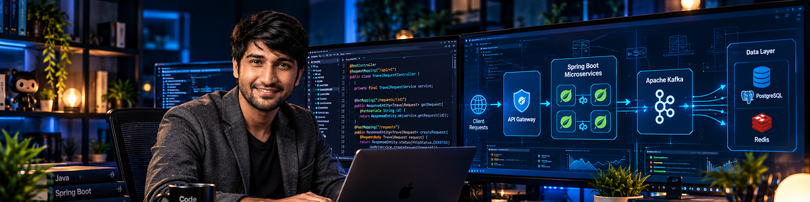

  

  <strong>Java Backend Engineer</strong> · Spring Boot · Microservices · Kafka · Secure APIs

  
  
  

---

## About Me

I'm a Java Backend Engineer focused on building **scalable APIs, secure integrations, and reliable backend services**. I enjoy working on service-to-service communication, event-driven workflows, authentication flows, and practical engineering problems.

- **Backend:** Java, Spring Boot, REST APIs, Microservices
- **Identity & Security:** SAML 2.0, OpenSAML, JWT, Spring Security, SSO
- **Messaging:** Apache Kafka, event-driven processing
- **Data:** PostgreSQL, MySQL, Redis, Spring Data JPA
- **Engineering interests:** API design, system design, testing, observability, production debugging

## Technology Stack

  

  
  
  
  

## Featured Projects

<table>
  <tr>
    <td width="50%" valign="top">
      <h3>🔐 <a href="https://github.com/rahuldevligri/sso_implementation">SSO Implementation</a></h3>
      
Spring Boot SAML integration focused on assertion handling, metadata, and secure authentication flows.

      
Java · Spring Boot · SAML 2.0 · Security

    </td>
    <td width="50%" valign="top">
      <h3>⚡ <a href="https://github.com/rahuldevligri/employee-onboarding-kafka-consumer">Kafka Consumer</a></h3>
      
Event-driven employee onboarding and message-consumer workflow.

      
Java · Apache Kafka · Event-driven systems

    </td>
  </tr>
  <tr>
    <td width="50%" valign="top">
      <h3>💳 <a href="https://github.com/rahuldevligri/Razorpay-Payment-Gateway-Integration">Razorpay Payment Gateway</a></h3>
      
Spring Boot payment integration with transaction handling and database persistence.

      
Java · Spring Boot · REST APIs · Database

    </td>
    <td width="50%" valign="top">
      <h3>🗂️ <a href="https://github.com/rahuldevligri/Project_Management_System">Project Management System</a></h3>
      
A Java project focused on organizing project data and core management workflows.

      
Java · Backend development

    </td>
  </tr>
</table>

  <a href="https://github.com/rahuldevligri?tab=repositories"><strong>Explore all repositories →</strong></a>

## Current Focus

- Designing clean, maintainable backend APIs and service boundaries
- Practicing data structures, algorithms, and system design
- Improving automated testing, logging, monitoring, and debugging habits
- Exploring secure integrations and reliable event-driven architectures

---

  <em>Build thoughtfully. Keep systems reliable. Keep learning.</em>

